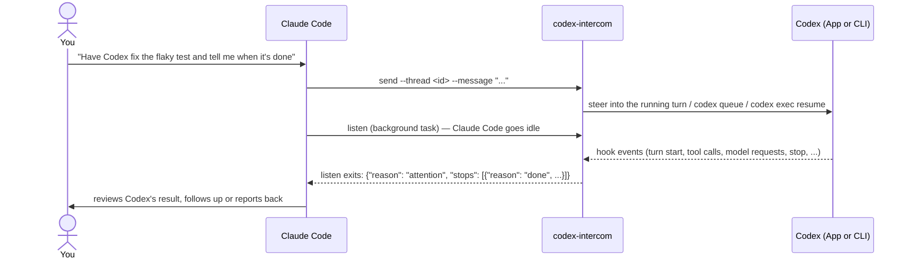

<div align="center">

# codex-intercom

### Let Claude Code drive your Codex sessions — and get told the moment Codex stops

Send or steer messages into any Codex session, get woken exactly once when it finishes, asks, errors or stalls,<br>
and get periodic progress check-ins on long tasks — while Claude Code stays idle.

[](https://github.com/MagicGeekSquad/codex-intercom/actions/workflows/test.yml)
[](https://github.com/MagicGeekSquad/codex-intercom/releases)
[](#requirements)
[](#requirements)
[](#requirements)
[](LICENSE)

English | [简体中文](README_ZH.md) | [Changelog](CHANGELOG.md)

**[Install](#installation) · [Quick Start](#quick-start) · [How it works](#how-it-works) · [Commands](#commands) · [FAQ](#faq)**

</div>

---

## Why codex-intercom?

Claude Code and Codex are great together: one plans and reviews, the other grinds through a long
implementation. The hard part is the hand-off. Without a link between them you end up
copy-pasting messages, polling with scheduled tasks, or finding out an hour later that Codex stopped
after five minutes to ask a question nobody saw.

codex-intercom is that link. It is a Claude Code skill plus a set of Codex hooks — built only on
documented Codex hooks and CLI commands — that turns a Codex session into something Claude Code can
talk to and wait on:

- **Talk** — Claude Code sends a message; if Codex is mid-turn it is steered into the running turn,
  otherwise it starts a new turn (in the Codex App, or headless via `codex exec` when the App doesn't
  have the session open).
- **Wait** — one background `listen` per Claude Code session watches every Codex session it manages
  and wakes Claude Code **exactly once** when one of them needs attention, with the reason and
  Codex's last reply. Claude Code stays idle in between — no polling, no token burn.
- **Check in** — long Codex tasks wake Claude Code every 30 minutes (configurable) with a progress
  snapshot, so it can course-correct without you setting up a scheduled task per session.

## Features

- **Steer or start** — mid-turn messages are injected at Codex's next tool call; idle sessions get a
  new turn via `codex queue`, with an automatic `codex exec resume` fallback in the session's own
  working directory.
- **Precise stop reasons** — `done`, `asking`, `approval`, `error` (capacity / rate limit / network),
  `interrupted`, `ended`, `stalled`, `not_started`, each with the details needed to act.
- **One listener, many sessions** — a single background process covers every Codex session a Claude
  Code session manages; stops that land together come in one report.
- **Nothing gets lost** — state is derived from Codex's hook events each time, so a stop that happened
  while nobody was listening is reported by the next `listen` (latest stop + how many were missed).
- **Exactly once** — each stop is reported once; a message that hasn't started yet never gets
  answered with the previous turn's result.
- **Progress check-ins** — per-session interval (`--checkin 10m`, `1h`, `off`); the snapshot includes
  Codex's own progress notes, recent commands and changed files.
- **Clear ownership** — a Codex session belongs to one Claude Code session; others are refused unless
  they explicitly `--take-over`. Ownership lapses on its own after 24 h of inactivity.
- **No dead-end popups** — while a session is managed, Codex asks its questions in its reply instead of
  App popups nobody would answer.
- **Zero dependencies** — a single Python 3.9+ standard-library script. Everything stays on your
  machine.

## How it works



- **Codex side:** `install` registers 8 hooks in `~/.codex/hooks.json` (`UserPromptSubmit`,
  `PostToolUse`, `Stop`, `Interrupt`, `PostModelRequest`, `PreModelRequest`, `PermissionRequest`, and a
  `PreToolUse` gate for question popups). They append to a per-session event log under
  `~/.codex/intercom/` and deliver steered messages. Existing hooks are kept; `hooks.json` is backed up
  before every change.
- **Claude Code side:** the skill teaches Claude Code to `send`, then run `listen` as a background
  task and end its turn. When the background task exits, Claude Code is notified and reads one JSON
  line describing what happened.
- **Who is the manager?** The Claude Code session, identified automatically by
  `$CLAUDE_CODE_SESSION_ID`. Any other orchestrator can drive Codex the same way by setting
  `$CODEX_INTERCOM_MANAGER`.

## Requirements

| | |
|---|---|
| OS | macOS or Linux (Windows is not supported) |
| Python | 3.9+, standard library only (`/usr/bin/python3` on macOS works) |
| Codex | [Codex CLI](https://github.com/openai/codex) with hooks (tested with `codex-cli` 0.167.2 and 0.169.0); the Codex App is optional |
| Claude Code | any recent version (uses skills and background Bash tasks) |

## Installation

### Option 1: install script (recommended)

```bash
curl -fsSL https://raw.githubusercontent.com/MagicGeekSquad/codex-intercom/main/install.sh | bash
```

or from a clone:

```bash
git clone https://github.com/MagicGeekSquad/codex-intercom.git
cd codex-intercom && ./install.sh
```

This installs the skill to `~/.claude/skills/codex-intercom/`, copies the hook script to
`~/.codex/hooks/` and registers the hooks in `~/.codex/hooks.json`. Re-run it any time to update.

### Option 2: Claude Code plugin

```text
/plugin marketplace add MagicGeekSquad/codex-intercom
/plugin install codex-intercom@codex-intercom
```

The plugin installs the skill only. The first time it is used, Claude Code runs `doctor`, sees the
Codex hooks missing and runs `install` for you (or run `install.sh` yourself). Use one option, not both.

### Then: trust the hooks in Codex (once)

Codex only runs hooks you have trusted:

- **Codex App:** Settings → Hooks → trust the `codex_intercom` entries.
- **Codex CLI:** the next time you start `codex` it says *Hooks need review* — review and trust them
  (or use `/hooks`).

Updates that only change the script don't need re-trusting; `install` tells you when they do.

### Verify

```bash
python3 ~/.claude/skills/codex-intercom/scripts/codex_intercom.py doctor
```

`doctor` checks the installed script, the hook registrations, the Codex CLI, and whether hook events
have actually been arriving (the real test that trust worked — use Codex once first).

## Quick Start

Start a **new** Claude Code session (skills load at session start) and give it a Codex session:

> Here's a Codex session: `codex://threads/0199f1c2-…`. Ask it to run the test suite and fix
> whatever fails, keep an eye on it, and tell me when it's done.

Claude Code will:

1. `send` the message — steered into the current turn if Codex is working, otherwise a new turn;
2. start `listen` in the background and go idle;
3. wake up when Codex stops (or at a progress check-in), read the result, and decide what's next:
   follow up with another `send`, answer Codex's question, or report back to you.

A Codex session is identified by its link (`codex://threads/<uuid>`, which you can copy from the Codex
App) or its UUID — the one `codex resume` takes, also the tail of its rollout file name under
`~/.codex/sessions/`.

You can manage several Codex sessions from one Claude Code session; give each a `--label` and one
`listen` covers them all.

## Commands

Claude Code runs these for you; they are listed here for reference and for scripting.
`CI` = `python3 ~/.claude/skills/codex-intercom/scripts/codex_intercom.py` (with the plugin, the same
script lives under `~/.claude/plugins/`).

| Command | What it does |
|---|---|
| `CI send --thread <id> --message "…"` | Deliver a message and take ownership of the session. Options: `--label NAME`, `--checkin 10m\|1h\|off`, `--queue` (never steer), `--via auto\|app\|exec`, `--take-over`. Reads stdin when `--message` is omitted. |
| `CI listen` | Block until any owned session needs attention, print one JSON line, exit. Run in the background; one per manager. Options: `--checkin 30m`, `--timeout N`. |
| `CI list` | Your sessions and their state (`working`, `waiting_start`, `stopped` + reason). `--all` shows every managed session and its manager. |
| `CI status --thread <id>` | One session in detail: owner, current state, progress snapshot, unreported stops, pending sends, popups, exec run, queue. |
| `CI claim --thread <id>` / `CI release --thread <id>` | Start managing a session without sending / hand it back (popups allowed again). |
| `CI doctor [--thread <id>]` | Check the installation and recent hook activity. |
| `CI install` / `CI uninstall [--remove-script]` | Register / remove the Codex hooks (`hooks.json` is backed up first). |
| `CI gc` | Delete data of old, unmanaged sessions. |

### What `listen` reports

```json
{"manager": "…", "reason": "attention",
 "stops": [{"thread": "0199f1c2-…", "label": "tests", "reason": "done", "at": "2026-11-13T09:56:09Z",
            "last_message": "All 214 tests pass. I fixed …", "summary": "…"}],
 "watching": [{"thread": "0199f1d8-…", "label": "docs", "state": "working", "in_flight": "tool"}],
 "summary": "…"}
```

`reason` is `attention` (something stopped or ownership changed), `checkin` (progress only),
`nothing_to_watch`, `already_listening`, `timeout` or `orphaned`. Claude Code re-arms `listen` while
`watching` or `progress` is not empty.

| Stop reason | Meaning |
|---|---|
| `done` | The turn finished; `last_message` is Codex's final reply (a question, if it needs input). |
| `asking` | A Codex App question popup is still open (only answerable in the App). |
| `approval` | Codex has been waiting for an approval for 30 s+ (only answerable in Codex). |
| `error` | A model request failed and Codex stopped (capacity, rate limit, network). Reported once per failure streak. |
| `interrupted` | Someone pressed stop. |
| `ended` | The headless `codex exec` run exited mid-turn. |
| `stalled` | No events for too long (5 min idle, 15 min in a model request, 30 min in a tool) — e.g. the App closed mid-turn. |
| `not_started` | A sent message didn't start a turn within 5 min (with what's blocking it). |

Each stop may also carry `earlier_stops` (stops nobody heard; only the latest is reported) and
`undelivered` (steered messages that missed the turn — they ride along with the next message).

### Progress check-ins

While a session keeps working, `listen` also exits with `reason: checkin` and a `progress` entry per
session: how long the turn has run, what is in flight, tool-call and model-request counts, and — read
from Codex's own session log — its latest progress notes, recent commands and changed files. Default
interval: 30 minutes; per session `send --checkin 10m` (or `off`); default for all `listen --checkin 1h`.
When Claude Code is woken anyway, every session past half its interval comes along, so it isn't woken
once per session.

## Configuration

| Variable | Default | Purpose |
|---|---|---|
| `CODEX_INTERCOM_DIR` | `~/.codex/intercom` | Data directory (event logs, ownership records). |
| `CODEX_INTERCOM_MANAGER` | `$CLAUDE_CODE_SESSION_ID`, else `cli` | Manager id, for orchestrators other than Claude Code. |
| `CODEX_INTERCOM_PYTHON` | `/usr/bin/python3`, else `python3` | Interpreter written into `hooks.json`. Keep it set if you set it. |

Timing flags (on `send`, `listen`, `list`, `status`): `--error-grace 15`, `--approval-grace 30`,
`--stall 300`, `--model-stall 900`, `--long-stall 1800`, `--start-timeout 300` (seconds).

## FAQ

<details>
<summary><b>Do I need the Codex App?</b></summary>

No. With the App, messages for sessions it has open are picked up there and you can watch them live.
Without it (or when the App doesn't have that session open), codex-intercom runs the turn headless with
`codex exec resume` in the session's original working directory. Mid-turn steering works for both.
</details>

<details>
<summary><b>What does it change on my machine?</b></summary>

It adds a skill under `~/.claude/skills/`, a script under `~/.codex/hooks/`, entries in
`~/.codex/hooks.json` (backed up before every change; other hooks are kept) and its data under
`~/.codex/intercom/`. `uninstall.sh` removes all of it (`--purge` also removes the data). Nothing leaves
your machine; the only network traffic is Codex's own.
</details>

<details>
<summary><b>Why does Claude Code run these commands outside its sandbox?</b></summary>

The script writes to `~/.codex/intercom/`, and `codex queue` / `codex exec` need network access, which
Claude Code's sandbox blocks. The skill asks Claude Code to run them with the sandbox disabled, so you
may see a permission prompt. For unattended runs, add an allow rule for the script in your Claude Code
permissions.
</details>

<details>
<summary><b>Why not just poll, or use a scheduled task?</b></summary>

Polling keeps Claude Code busy and burns tokens; a scheduled task wakes it whether or not anything
happened, and has to be set up per session. `listen` is a background task whose exit is the wake-up:
Claude Code is idle until a Codex session actually needs it, and check-ins are built in.
</details>

<details>
<summary><b>Can two Claude Code sessions manage the same Codex session?</b></summary>

No — that is how duplicate instructions and lost reports happen. The second one is refused (exit code 2,
with who owns it) unless it passes `--take-over`, in which case the previous owner's `listen` reports
the session as `lost`.
</details>

<details>
<summary><b>Why is some tool output in Chinese?</b></summary>

The runtime messages (summaries, the note Codex sees when a popup is blocked) and the skill
instructions are written in Chinese. Claude Code reads them and still answers you in your language;
Codex reads them fine too. Translations are welcome as pull requests.
</details>

<details>
<summary><b>What if a Codex update changes things?</b></summary>

Core behaviour depends only on documented Codex hooks and CLI commands. Two extras are best-effort:
detecting whether the App took a queued message (reads Codex's queue database, read-only) and the
progress snapshot (reads Codex's session log). If either format changes, those extras degrade
gracefully; stop detection keeps working. Run `doctor` after upgrading Codex.
</details>

## Troubleshooting

- **`send` always starts a new turn although Codex is working, or sends end up `not_started`:** the
  hooks aren't running. Run `doctor`; most often they haven't been trusted in Codex yet.
- **`doctor` warns that no events arrived:** trust the hooks (App: Settings → Hooks; CLI: `/hooks`),
  use Codex once, run `doctor` again.
- **A message is stuck behind a popup** (`transport: blocked`): a question popup opened before the
  session was managed; answer, skip or cancel it in the Codex App.
- **Debug logging:** `touch ~/.codex/intercom/DEBUG` records raw hook input to `debug.log` (it contains
  prompts — delete both when done). Script errors go to `~/.codex/intercom/errors.log`.

## Uninstall

```bash
./uninstall.sh            # from a clone; or: bash <(curl -fsSL https://raw.githubusercontent.com/MagicGeekSquad/codex-intercom/main/uninstall.sh)
./uninstall.sh --purge    # also delete ~/.codex/intercom
```

Installed as a plugin? Run the uninstaller for the Codex side, then `/plugin uninstall codex-intercom`.

## Development

```text
skills/codex-intercom/SKILL.md                 instructions Claude Code loads
skills/codex-intercom/scripts/codex_intercom.py the whole implementation (CLI + hooks)
tests/test_intercom.py                         test suite (fake Codex, fake queue store, no network)
tests/fake_codex.py                            stand-in for the codex binary
.claude-plugin/                                plugin + marketplace manifests
install.sh / uninstall.sh                      installers
```

```bash
python3 tests/test_intercom.py          # ~125 checks, a few minutes
```

The script's module docstring is the design reference: the data model, how attention is derived, and
every stop reason.

## Contributing

Issues and pull requests are welcome. For anything beyond a small fix, please open an issue first to
discuss the approach. Keep the script dependency-free and add a test for behaviour changes.

## License

[MIT](LICENSE) © MagicGeekSquad

codex-intercom is an independent project and is not affiliated with OpenAI or Anthropic.
