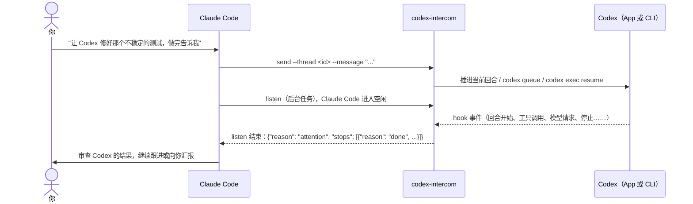

<div align="center">

# codex-intercom

### 让 Claude Code 指挥你的 Codex session，Codex 一停下就知道

向任意 Codex session 发消息或在它工作时插话；它做完、提问、出错或卡住时，只叫醒你一次；<br>
长任务还会定期汇报进展。等待期间 Claude Code 保持空闲。

[](https://github.com/MagicGeekSquad/codex-intercom/actions/workflows/test.yml)
[](https://github.com/MagicGeekSquad/codex-intercom/releases)
[](#环境要求)
[](#环境要求)
[](#环境要求)
[](LICENSE)

[English](README.md) | 简体中文 | [更新日志](CHANGELOG.md)

**[安装](#安装) · [快速上手](#快速上手) · [工作原理](#工作原理) · [命令](#命令) · [常见问题](#常见问题)**

</div>

---

## 为什么需要 codex-intercom？

Claude Code 和 Codex 搭配起来很好用：一个负责规划和审查，一个埋头完成长时间的实现。难的是两者之间的交接。
没有一条通道，你只能来回复制粘贴消息、用定时任务轮询，或者一个小时后才发现 Codex 五分钟时就停下来提了个问题，
却没人看见。

codex-intercom 就是这条通道。它是一个 Claude Code skill 加一组 Codex hooks，只基于 Codex 公开的 hooks 和 CLI 命令，
让 Claude Code 可以和 Codex session 对话、等它停下：

- **说**：Claude Code 发一条消息。Codex 正在工作时插进当前回合，停着时开新一轮（在 Codex App 里；
  App 没打开这个 session 时用 `codex exec` 在后台运行）。
- **等**：每个 Claude Code 会话只跑一个后台 `listen`，盯住它管理的所有 Codex session。任何一个需要处理时，
  **只叫醒一次**，并带上原因和 Codex 的最后回复。期间 Claude Code 是空闲的：不轮询，不耗 token。
- **查**：Codex 长任务每 30 分钟（可调）唤醒一次 Claude Code，附带进展快照，方便及时纠偏，
  不用再给每个会话手动设定时任务。

## 功能特性

- **插话或开新一轮**：Codex 工作时，消息在它下一次工具调用后注入；停着时通过 `codex queue` 开新一轮，
  App 没接手就自动改用 `codex exec resume`，在 session 原来的工作目录里运行。
- **准确的停止原因**：`done`、`asking`、`approval`、`error`（容量不足、限流、网络）、`interrupted`、`ended`、
  `stalled`、`not_started`，每种都附带下一步需要的信息。
- **一个监听，多个 session**：一个后台进程覆盖一个 Claude Code 会话管理的所有 Codex session；
  差不多同时停下的会合并成一次通知。
- **不会漏报**：每次都从 Codex 的 hook 事件现场推算状态。没人听时发生的停下，下次 `listen` 会立刻报告
  （只报最近一次，另附漏掉了几次）。
- **只报一次**：每次停下只报告一次；消息还没开始处理时，不会把上一轮的结果当成它的回复。
- **定期查看进展**：每个 session 可单独设置间隔（`--checkin 10m`、`1h`、`off`）；快照里有 Codex
  自己写的进度说明、最近执行的命令和改过的文件。
- **归属清晰**：一个 Codex session 只归一个 Claude Code 会话管理，别的会话来发消息会被拒绝，
  除非明确 `--take-over`。管理者 24 小时没有活动后自动失效。
- **不再有没人回答的弹窗**：被管理期间，Codex 把问题写在回复里，而不是弹出没人处理的 App 提问框。
- **零依赖**：单个 Python 3.9+ 标准库脚本，所有数据都留在本机。

## 工作原理



- **Codex 侧**：`install` 在 `~/.codex/hooks.json` 里注册 8 个 hooks（`UserPromptSubmit`、`PostToolUse`、`Stop`、
  `Interrupt`、`PostModelRequest`、`PreModelRequest`、`PermissionRequest`，以及拦截提问弹窗的 `PreToolUse`）。
  它们把事件写进 `~/.codex/intercom/` 下每个 session 的日志，并负责投递插话。已有的 hooks 会保留，
  每次修改 `hooks.json` 前都会先备份。
- **Claude Code 侧**：skill 教 Claude Code 先 `send`，再以后台任务运行 `listen` 并结束本轮。后台任务结束时
  Claude Code 收到通知，读取一行 JSON，就知道发生了什么。
- **谁是管理者？** 当前的 Claude Code 会话，通过 `$CLAUDE_CODE_SESSION_ID` 自动识别。其他编排程序设置
  `$CODEX_INTERCOM_MANAGER` 后也能用同样的方式驱动 Codex。

## 环境要求

| | |
|---|---|
| 操作系统 | macOS 或 Linux（不支持 Windows） |
| Python | 3.9+，只用标准库（macOS 自带的 `/usr/bin/python3` 即可） |
| Codex | 支持 hooks 的 [Codex CLI](https://github.com/openai/codex)（在 `codex-cli` 0.167.2 和 0.169.0 上测试）；Codex App 可选 |
| Claude Code | 较新的版本即可（用到 skills 和后台 Bash 任务） |

## 安装

### 方式一：安装脚本（推荐）

```bash
curl -fsSL https://raw.githubusercontent.com/MagicGeekSquad/codex-intercom/main/install.sh | bash
```

或者从克隆的仓库安装：

```bash
git clone https://github.com/MagicGeekSquad/codex-intercom.git
cd codex-intercom && ./install.sh
```

它会把 skill 装到 `~/.claude/skills/codex-intercom/`，把 hook 脚本复制到 `~/.codex/hooks/`，并在
`~/.codex/hooks.json` 里注册 hooks。随时重新运行即可更新。

### 方式二：Claude Code 插件

```text
/plugin marketplace add MagicGeekSquad/codex-intercom
/plugin install codex-intercom@codex-intercom
```

插件只安装 skill。第一次使用时，Claude Code 会先跑 `doctor`，发现 Codex hooks 没装就替你运行 `install`
（你也可以自己运行 `install.sh`）。两种方式选一种即可，不要同时用。

### 然后：在 Codex 里信任 hooks（只需一次）

Codex 只运行你信任过的 hooks：

- **Codex App**：Settings → Hooks，信任 `codex_intercom` 的条目。
- **Codex CLI**：下次启动 `codex` 时会提示 *Hooks need review*，检查后信任即可（也可以用 `/hooks`）。

只更新脚本时不需要重新信任；需要时 `install` 会提示你。

### 验证

```bash
python3 ~/.claude/skills/codex-intercom/scripts/codex_intercom.py doctor
```

`doctor` 会检查已安装的脚本、hooks 注册情况、Codex CLI，以及 hook 事件是否真的在到达。最后一项才是信任
是否生效的真正检验，所以先用一次 Codex 再跑。

## 快速上手

**新开**一个 Claude Code 会话（skills 在会话启动时加载），把一个 Codex session 交给它：

> 这是一个 Codex session：`codex://threads/0199f1c2-…`。让它跑一遍测试、修好失败的用例，盯着点，做完告诉我。

Claude Code 会：

1. 用 `send` 发出消息：Codex 正在工作就插进当前回合，否则开新一轮；
2. 在后台启动 `listen`，然后进入空闲；
3. Codex 停下（或到了查看进展的时间）时被唤醒，读取结果，再决定下一步：继续 `send` 跟进、回答 Codex 的问题，
   或者向你汇报。

Codex session 可以用链接（`codex://threads/<uuid>`，可从 Codex App 复制）或 UUID 指定。UUID 就是
`codex resume` 接受的那个 id，也是 `~/.codex/sessions/` 下会话记录文件名的结尾部分。

一个 Claude Code 会话可以同时管理多个 Codex session：给每个加上 `--label`，一个 `listen` 就能全部覆盖。

## 命令

这些命令由 Claude Code 替你运行，列在这里供查阅和写脚本时使用。
`CI` = `python3 ~/.claude/skills/codex-intercom/scripts/codex_intercom.py`（插件安装时，同一个脚本在
`~/.claude/plugins/` 下）。

| 命令 | 作用 |
|---|---|
| `CI send --thread <id> --message "…"` | 发消息，并开始管理这个 session。选项：`--label 短名`、`--checkin 10m\|1h\|off`、`--queue`（不插话）、`--via auto\|app\|exec`、`--take-over`。省略 `--message` 时从 stdin 读取。 |
| `CI listen` | 阻塞到任何一个被管理的 session 需要处理，输出一行 JSON 后退出。后台运行，每个管理者一个。选项：`--checkin 30m`、`--timeout N`。 |
| `CI list` | 你管理的 session 及其状态（`working`、`waiting_start`、`stopped` + 原因）。`--all` 列出所有被管理的 session 和各自的管理者。 |
| `CI status --thread <id>` | 单个 session 的细节：管理者、当前状态、进展快照、未报告的停下、未开始的消息、弹窗、exec 进程、队列。 |
| `CI claim --thread <id>` / `CI release --thread <id>` | 不发消息也开始管理 / 交还（恢复 App 弹窗提问）。 |
| `CI doctor [--thread <id>]` | 检查安装情况和最近的 hook 活动。 |
| `CI install` / `CI uninstall [--remove-script]` | 注册 / 移除 Codex hooks（先备份 `hooks.json`）。 |
| `CI gc` | 删除很久没动、无人管理的 session 数据。 |

### `listen` 的输出

```json
{"manager": "…", "reason": "attention",
 "stops": [{"thread": "0199f1c2-…", "label": "tests", "reason": "done", "at": "2026-11-13T09:56:09Z",
            "last_message": "214 个测试全部通过。我修改了……", "summary": "…"}],
 "watching": [{"thread": "0199f1d8-…", "label": "docs", "state": "working", "in_flight": "tool"}],
 "summary": "…"}
```

`reason` 取值：`attention`（有 session 停下或归属变化）、`checkin`（只是查看进展）、`nothing_to_watch`、
`already_listening`、`timeout`、`orphaned`。只要 `watching` 或 `progress` 不为空，Claude Code 就会再次启动 `listen`。

| 停止原因 | 含义 |
|---|---|
| `done` | 本轮结束，`last_message` 是 Codex 的最后回复（需要你决定时，问题就在这里）。 |
| `asking` | Codex App 里还开着提问弹窗（只能在 App 里回答）。 |
| `approval` | Codex 等批准已超过 30 秒（只能在 Codex 里处理）。 |
| `error` | 模型请求失败后停下（容量不足、限流、网络）。同一段连续失败只报一次。 |
| `interrupted` | 有人点了停止。 |
| `ended` | 后台的 `codex exec` 进程在回合中途退出。 |
| `stalled` | 太久没有任何事件（空闲 5 分钟、模型请求中 15 分钟、工具运行中 30 分钟），比如 App 在回合中途被关掉。 |
| `not_started` | 发出的消息 5 分钟内没有开始处理（附带卡在哪里）。 |

每项还可能带 `earlier_stops`（没人听到的停下次数，只报最近一次）和 `undelivered`（没赶上那一轮的插话，
会随下一条消息一起发给 Codex）。

### 定期查看进展

session 一直在工作时，`listen` 也会以 `reason: checkin` 结束，每个 session 附一份 `progress`：本轮跑了多久、
现在在做什么、工具调用和模型请求次数，以及从 Codex 自己的会话记录里读出的最新进度说明、最近执行的命令和
改过的文件。默认间隔 30 分钟；单个 session 用 `send --checkin 10m`（或 `off`）；全局默认用 `listen --checkin 1h`。
反正要唤醒时，已过半个间隔的 session 会一起带上，免得逐个叫醒。

## 配置

| 环境变量 | 默认值 | 用途 |
|---|---|---|
| `CODEX_INTERCOM_DIR` | `~/.codex/intercom` | 数据目录（事件日志、归属记录）。 |
| `CODEX_INTERCOM_MANAGER` | `$CLAUDE_CODE_SESSION_ID`，否则 `cli` | 管理者 id，供 Claude Code 以外的编排程序使用。 |
| `CODEX_INTERCOM_PYTHON` | `/usr/bin/python3`，否则 `python3` | 写进 `hooks.json` 的解释器。设置了就要一直保持设置。 |

时间参数（`send`、`listen`、`list`、`status` 都接受，单位秒）：`--error-grace 15`、`--approval-grace 30`、
`--stall 300`、`--model-stall 900`、`--long-stall 1800`、`--start-timeout 300`。

## 常见问题

<details>
<summary><b>需要 Codex App 吗？</b></summary>

不需要。有 App 时，它打开着的 session 会在 App 里接收消息，你可以实时看到。没有 App（或 App 没打开这个 session）
时，codex-intercom 用 `codex exec resume` 在 session 原来的工作目录里后台运行。两种情况都支持运行中插话。
</details>

<details>
<summary><b>它会改动我机器上的什么？</b></summary>

在 `~/.claude/skills/` 下装一个 skill，在 `~/.codex/hooks/` 下放一个脚本，在 `~/.codex/hooks.json` 里加几条 hooks
（每次修改前都备份，其他 hooks 保留），数据放在 `~/.codex/intercom/`。`uninstall.sh` 会全部移除（`--purge`
连数据一起删）。没有任何数据离开你的机器，唯一的网络流量是 Codex 自己的。
</details>

<details>
<summary><b>为什么 Claude Code 要在沙箱外运行这些命令？</b></summary>

脚本要写 `~/.codex/intercom/`，`codex queue` 和 `codex exec` 要联网，Claude Code 的沙箱会拦住这些操作。
skill 会让 Claude Code 关闭沙箱运行它们，所以你可能会看到权限确认。想无人值守运行，可以在 Claude Code 的
权限设置里给这个脚本加一条放行规则。
</details>

<details>
<summary><b>为什么不直接轮询，或者用定时任务？</b></summary>

轮询让 Claude Code 一直忙着，白白消耗 token；定时任务不管有没有事都会唤醒，而且每个会话都要单独设置。
`listen` 是一个后台任务，它结束就是唤醒信号：Codex session 真正需要处理之前，Claude Code 一直空闲，
定期查看进展也已内置。
</details>

<details>
<summary><b>两个 Claude Code 会话能同时管理同一个 Codex session 吗？</b></summary>

不能，那正是指令重复、通知丢失的根源。第二个会话会被拒绝（退出码 2，并说明归谁管理），除非它加
`--take-over`；接管后，原管理者的 `listen` 会把这个 session 报为 `lost`。
</details>

<details>
<summary><b>为什么有些工具输出是中文？</b></summary>

运行时的文字（摘要、弹窗被拦截时 Codex 看到的说明）和 skill 说明都是中文写的。Claude Code 读得懂，
仍会用你的语言回复你；Codex 也读得懂。欢迎提交其他语言的翻译。
</details>

<details>
<summary><b>Codex 升级后会不会失效？</b></summary>

核心功能只依赖 Codex 公开的 hooks 和 CLI 命令。有两项是尽力而为的增强：判断 App 是否取走了排队的消息
（只读 Codex 的队列数据库），以及进展快照（读 Codex 的会话记录）。这两种格式变化时，这两项会平稳降级，
停止检测照常工作。升级 Codex 后跑一次 `doctor`。
</details>

## 排障

- **Codex 明明在工作，`send` 却总是开新一轮，或者消息总是 `not_started`**：hooks 没在运行。先跑 `doctor`，
  最常见的原因是还没在 Codex 里信任它们。
- **`doctor` 提示没收到事件**：信任 hooks（App：Settings → Hooks；CLI：`/hooks`），用一次 Codex，再跑 `doctor`。
- **消息被弹窗挡住**（`transport: blocked`）：开始管理之前就弹出的提问框还没处理，在 Codex App 里回答、
  跳过或取消它。
- **调试日志**：`touch ~/.codex/intercom/DEBUG` 会把原始 hook 输入记到 `debug.log`（里面有提示词内容，
  排障完把两者都删掉）。脚本错误记在 `~/.codex/intercom/errors.log`。

## 卸载

```bash
./uninstall.sh            # 在克隆的仓库里运行；或：bash <(curl -fsSL https://raw.githubusercontent.com/MagicGeekSquad/codex-intercom/main/uninstall.sh)
./uninstall.sh --purge    # 同时删除 ~/.codex/intercom
```

用插件安装的？先运行卸载脚本处理 Codex 侧，再执行 `/plugin uninstall codex-intercom`。

## 开发

```text
skills/codex-intercom/SKILL.md                 Claude Code 加载的说明
skills/codex-intercom/scripts/codex_intercom.py 全部实现（CLI + hooks）
tests/test_intercom.py                         测试（模拟 Codex 和队列库，不联网）
tests/fake_codex.py                            代替 codex 命令的测试替身
.claude-plugin/                                插件与 marketplace 清单
install.sh / uninstall.sh                      安装与卸载脚本
```

```bash
python3 tests/test_intercom.py          # 约 125 项检查，需要几分钟
```

脚本开头的模块文档是设计参考：数据模型、如何推算“需要处理”，以及每种停止原因。

## 参与贡献

欢迎提 issue 和 pull request。小修以外的改动，请先开 issue 讨论方案。请保持脚本零依赖，行为变化请补测试。

## 许可证

[MIT](LICENSE) © MagicGeekSquad

codex-intercom 是独立项目，与 OpenAI、Anthropic 没有关联。
